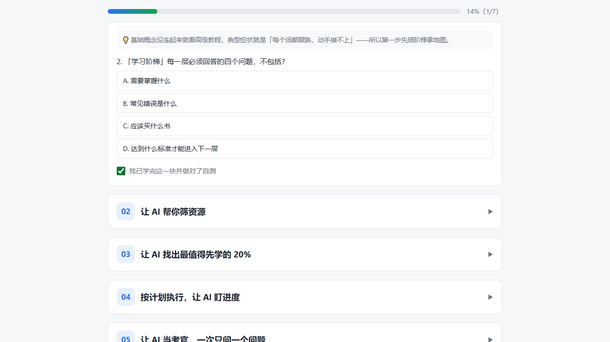

# AI 学习法：用 AI 助手高效学会一门新技能的 7 个方法

> 适用于任何 AI 助手 / Agent：Codex、Claude Code、Cursor、ChatGPT、Gemini、Kimi、GLM、DeepSeek 等均可。文中统一用「AI」指代你的助手。

## 🖱️ 交互式网页版（推荐先看这个）

**在线打开：** <https://escatial.github.io/ai-learning-playbook/>

单文件网页、无任何依赖，把 7 个方法变成可点可练的页面：

- 学习阶梯 L1–L5 自评（点选你的当前层）
- 每个方法的提示词**一键复制**
- 自测题**即时判分**（做对才算过关，附解析）
- 打卡进度条（进度自动存在浏览器 localStorage，仅本机）
- 7 张速查翻卡（点击翻面）



---

学一个新东西，别一上来就冲复杂项目。基础概念还没连起来就去看高级教程，很容易出现一种情况：每个词都眼熟，真到自己动手又接不上。AI 最大的价值不是替你学，而是把「学什么、学多久、学到什么程度」变成可执行的小步骤——下面 7 个方法组成一条完整的学习流水线。

---

## 01 先让 AI 搭一套学习阶梯

基础概念没连起来，就去看高级教程，结果往往是「看懂了，但不会做」。第一步不是学，而是先拿一张地图。

**提示词模板：**

> 请把「XX」拆成 5 个学习等级，从完全新手到能独立做项目。每一层告诉我：
> ① 需要掌握什么；② 常见错误是什么；③ 应该做什么练习；④ 达到什么标准才能进入下一层。

**要点：** 这一步你会知道自己现在在哪一层、下一步该补什么、什么时候算真的过关。有了地图，后面的学习才不会迷路。

---

## 02 让 AI 帮你筛资源

现在学习最麻烦的地方，很多时候是资源太多。书、课程、视频、博客、社群、博主，收藏了一堆，最后哪个都没开始。

**提示词模板：**

> 我想学习「XX」。请帮我筛选最值得看的 5 个资源。每个资源说明：适合谁、难度如何、该怎么用、哪些部分可以跳过。最后用这 5 个资源，帮我设计一个 7 天学习路径。

**要点：** 这一步是在减少选择成本。真正有用的学习路径，不需要堆满资料——能看完、能练、能复盘，才有价值。

---

## 03 让 AI 找出最值得先学的 20%

任何技能里，都有一部分内容最先带来回报。学剪辑，不用一开始研究所有插件；学写作，不用先背一堆理论；学编程，也不用一上来啃完整文档。

**提示词模板：**

> 我想用 20 小时学习「XX」。请找出这个主题里最重要的 20% 内容，并设计成 10 次学习计划，每次 2 小时。每次都要包含：学习目标、练习任务、复盘问题。

**要点：** 一个很大的目标，会被拆成今天就能完成的一小块。学习最怕「大而虚」，一旦变成 10 次明确的训练，执行难度会低很多。

---

## 04 按计划执行，让 AI 盯进度

计划再好，不执行等于零。10 次训练拿到手后，关键是用固定的节奏把每一次跑完。

**每次 2 小时的参考节奏：**

- **前 30 分钟**：只学本次的学习目标涉及的概念，让 AI 用通俗的方式先讲一遍；
- **中间 70 分钟**：动手做练习任务，卡住就把报错或卡点直接丢给 AI，不要自己闷头耗超过半小时；
- **最后 20 分钟**：口头回答计划里的复盘问题，让 AI 判断你这次是否过关、能否进入下一块。

**要点：** 每次训练结束时，把完成情况告诉 AI，让它对比 03 里的计划帮你确认进度。缺一次就当场补，不积压。

---

## 05 让 AI 当考官，一次只问一个问题

很多时候，我们以为自己学会了，其实只是看懂了别人怎么讲。真正检验理解，要靠自己说出来、做出来、答出来。

**提示词模板：**

> 我刚学完「XX」，请你当我的考官。一次只问我一个问题，从简单到困难。我回答后，请给我打分，并指出：哪里对，哪里错，哪里理解不完整。然后只重新解释我没掌握的部分。

**要点：** 最关键的是**一次只问一个问题**。别让 AI 一口气出 20 道题。一问一答，反馈更具体，你的薄弱点会立刻露出来，AI 也能针对那一小块重新讲。

---

## 06 每学完一块，让 AI 做一页速查表

不要把整段聊天记录都存下来——聊天记录太长，后面基本不会再翻。每学完一个主题，让 AI 压成一页。

**提示词模板：**

> 请把我刚刚学的内容整理成一页速查表。包含：
> ① 一句话定义；② 核心概念；③ 真实例子；④ 常见错误；⑤ 使用前检查清单；⑥ 5 个自测问题。

**要点：** 这张速查表很适合考试前、面试前、组会前、开题前、做项目之前看。你不用重新学一遍，只要把脑子里的结构唤醒。

---

## 07 用费曼学习法，让 AI 逼你讲明白

如果一个概念你讲不清，大概率还没真正理解。

**提示词模板：**

> 请先用 12 岁孩子能听懂的话解释「XX」。然后我会用我自己的话复述。你帮我判断哪里讲对了，哪里漏了，哪里混淆了，哪里用了听起来高级但其实没说明白的词。然后让我重新讲一遍，直到我讲清楚为止。

**要点：** 这个方法特别适合学抽象概念。很多知识，看答案的时候很清楚；等到自己开口讲，漏洞才会冒出来。

---

## 7 个方法怎么组合

它们不是并列的技巧，而是一条学习流水线：

```
01 阶梯（知道自己在哪） → 02 筛资源（确定学什么）
→ 03 找 20%（拆成 10 次训练） → 04 执行（按节奏跑完）
→ 05 考官（检验学没学会） → 06 速查表（沉淀成一页）
→ 07 费曼（讲明白才算真懂）
```

学下一个新主题时，从头再走一遍即可。AI 负责拆解、筛选、出题、批改；你负责动手、回答、复述——分工越清楚，学得越快。
